


 

 


- 🤖 Building **autonomous mobile robots**, from CAD to control to perception
- 👁️ Computer vision with **TensorFlow**: lane detection, traffic signs, vehicle detection, behavioural cloning
- 🔭 Currently deepening my work in **ROS2** and robot simulation
- 💬 Open to collaborations, research and engineering roles. Let's connect!

 



 


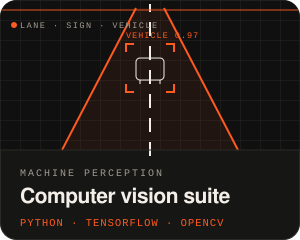

 



 


<!-- OPTIONAL: contribution snake. Uncomment AFTER the "Generate Snake" workflow has run once (Actions tab).

-->

 

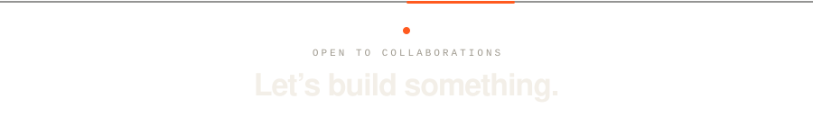
